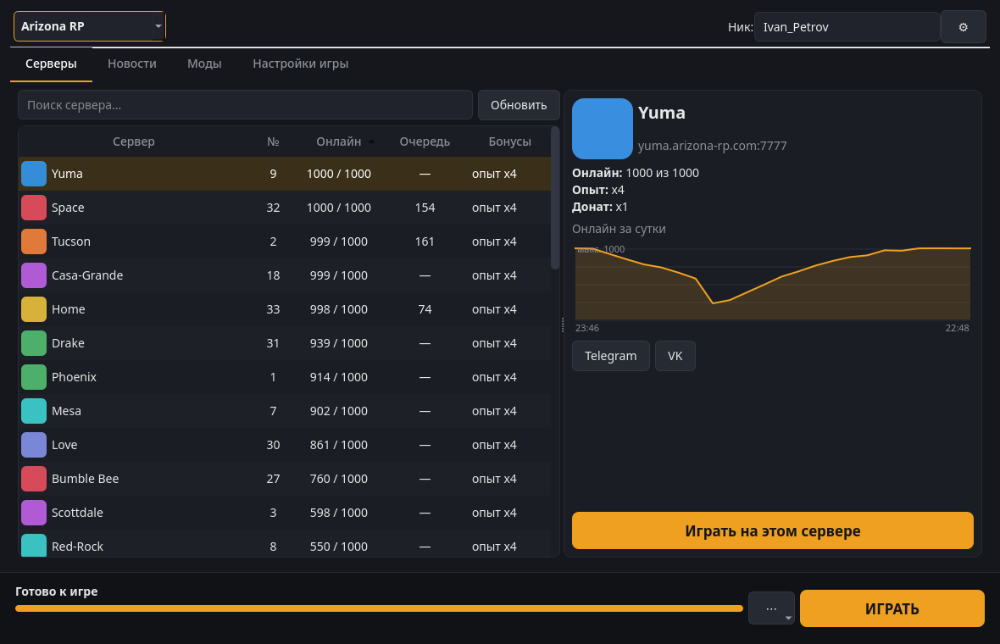
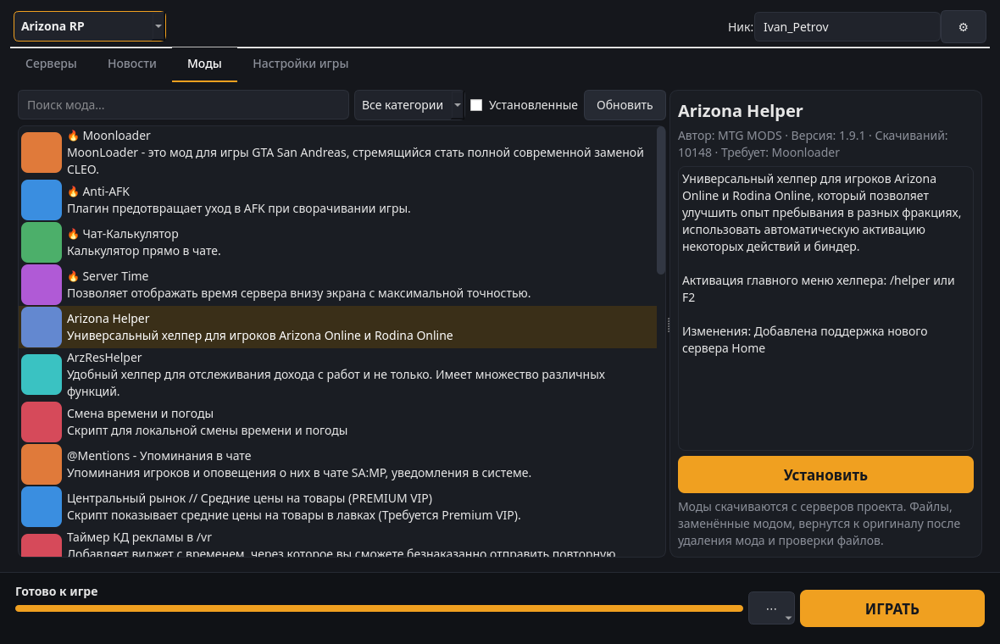
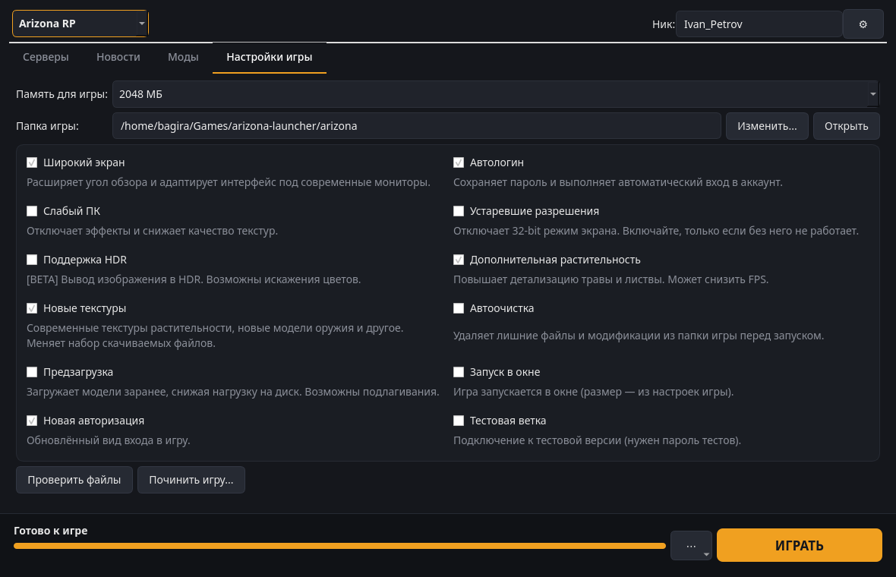

# Arizona Launcher for Linux

[](https://github.com/alinaz18/arizona-launcher-linux/actions/workflows/ci.yml) [](LICENSE)

[Русский](README.md) | **English**

An unofficial native Linux launcher for **Arizona RP**, **Rodina RP** and "Village Life". It downloads and updates the game from the same servers as the official launcher, shows servers, news and the mod catalog, and starts the game through Wine. The interface is Qt.



> **Note.** This project is not affiliated with Arizona Games. The game itself (`gta_sa.exe` with the project client) is Windows-only, so it runs through **Wine**. The launcher creates a separate Wine prefix and installs the components it needs.

## Features

- Server list: players, queue, bonuses (experience/donate), 24-hour online graph, server Telegram and VK links.
- Game install and updates. Files are checked by size, date and MD5 and downloaded in parallel over
  reused connections. If the main mirror is down, the launcher switches to the reserve one.
- A quick file check before every launch, like the original.
- "Repair game": a full MD5 check plus removal of extra files. Settings, mods, voice chat and cache can be kept.
- The project mod catalog: install with dependencies, update, remove, warnings about conflicts.
- Project news and links to the site, forum, Telegram, VK and Discord.
- The same launch options as the original: widescreen, auto-login, new textures, low-end PC, windowed,
  HDR, test branch and more. The memory limit can be set.
- One-click Wine setup (like "Install drivers"): DXVK, DirectX 9, VC++ 2010/2013/2022, fonts.
- The launcher hides to the tray while you play. If the game crashes soon after start, it offers a file check.
- Icon: if the official Arizona launcher is on the computer (the installer in Downloads or
  `Arizona Games Launcher.exe`), its original icon is used for the menu entry, dock and window.
  If the file is somewhere else, pick it in ⚙ → "Иконка из .exe...". The icon is not stored in this repository.

Arizona V (GTA V / RAGE MP) and Trilogy are not supported.

## Screenshots

| Mod catalog | Game settings |
|---|---|
|  |  |

In the screenshots, server icons and mod images are replaced with colored placeholders. The launcher itself loads them from the project servers.

## Requirements

- Python 3.9+ and PySide6 (Qt 6);
- Wine and winetricks (with cabextract);
- about 11 GB of free space per game.

`install.sh` installs all of this.

## Installation

```sh
git clone https://github.com/alinaz18/arizona-launcher-linux.git
cd arizona-launcher-linux
./install.sh
```

Supported: Arch / CachyOS / Manjaro / EndeavourOS, Debian / Ubuntu / Mint, Fedora, openSUSE.
If the dependencies are already installed, run `./install.sh --no-deps`. To see what would be done without changing anything, run `./install.sh --dry-run`.

The launcher then appears in the application menu as "Arizona Launcher". From a terminal, run `arizona-launcher`.

## First run

1. Pick the project (Arizona RP, Rodina RP or Village Life) and enter a nickname like `Nick_Name`.
2. Press **УСТАНОВИТЬ** (Install). The game goes to `~/Games/arizona-launcher/<game>` by default;
   the folder can be changed on the "Настройки игры" (Game settings) tab.
3. Pick a server and press **ИГРАТЬ** (Play). Before the first launch the launcher offers to set up Wine,
   which takes a few minutes.

The interface is in Russian, like the game itself.

## Troubleshooting

- **The game does not start or closes at once.** Check the Wine log (⋯ → "Журнал Wine").
  Try "Починить игру" (Repair) and "Установить компоненты Wine" (Wine components).
- **Low FPS.** Enable "Слабый ПК" (low-end PC) and disable "Дополнительная растительность" (extra vegetation).
- **The game hangs.** ⚙ → "Закрыть игру" ends all Wine processes of this launcher.

## Files

| What | Path |
|---|---|
| Launcher | `~/.local/share/arizona-launcher-app/` |
| Game | `~/Games/arizona-launcher/<game>` |
| Settings | `~/.config/arizona-launcher/config.json` |
| Wine prefix and log | `~/.local/share/arizona-launcher/` |
| Image cache | `~/.cache/arizona-launcher/` |
| Icon taken from the official launcher | `~/.local/share/icons/hicolor/*/apps/arizona-launcher-original.png` |

## Uninstall

```sh
./uninstall.sh          # launcher only; settings, Wine and the game stay
./uninstall.sh --purge  # plus settings and the Wine prefix
```

Downloaded game files are never removed. Delete `~/Games/arizona-launcher` by hand if you want.

## How it works

`arizona_core.py` is the engine without UI, `arizona_launcher.py` is the window.
The file list comes from `<CDN>/game.json`, and files are downloaded from `<CDN>/game/<path>`.
The game is started as `gta_sa.exe -c -h <ip> -p <port> -n <nick> -mem <MB> ...` with the same flags as the official launcher.

## License

[MIT](LICENSE). Arizona RP and Rodina RP are trademarks of their respective owners.
