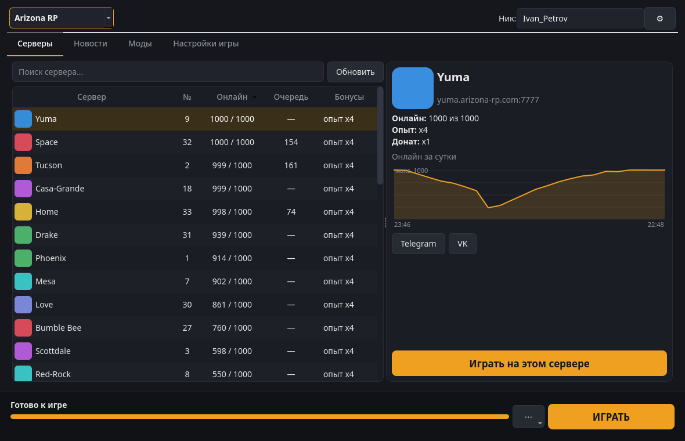
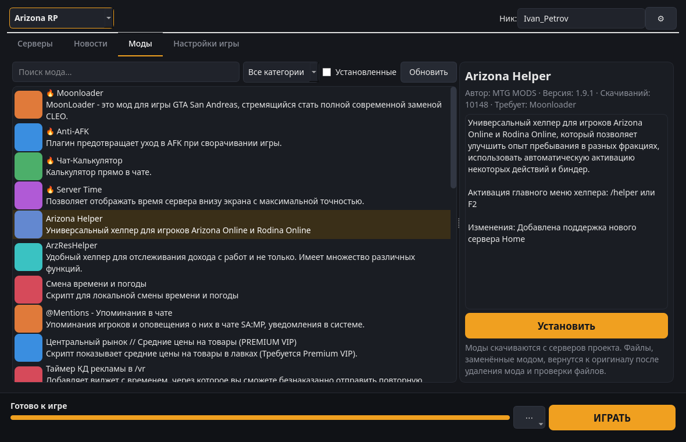
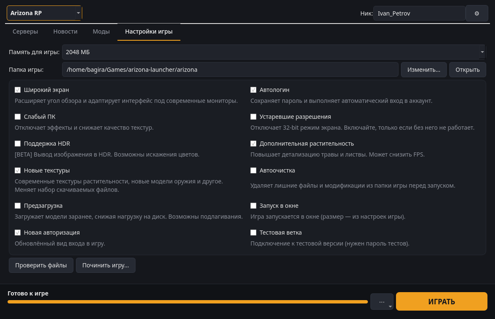

# Arizona Launcher для Linux

[](https://github.com/alinaz18/arizona-launcher-linux/actions/workflows/ci.yml) [](https://github.com/alinaz18/arizona-launcher-linux/actions/workflows/watchdog.yml) [](https://github.com/alinaz18/arizona-launcher-linux/releases/latest) [](LICENSE)

**Русский** | [English](README.en.md)

Неофициальный нативный лаунчер для **Arizona RP**, **Rodina RP** и «Жизни в деревне» на Linux. Он скачивает и обновляет игру с тех же серверов, что и официальный лаунчер, показывает серверы, новости и каталог модов и запускает игру через Wine. Интерфейс на Qt.



> **Важно.** Проект не связан с Arizona Games. Сама игра (`gta_sa.exe` с клиентом проекта) существует только под Windows, поэтому запускается через **Wine**. Лаунчер сам создаёт для неё отдельное окружение и ставит нужные компоненты.

## Возможности

- Список серверов: онлайн, очередь, бонусы (опыт/донат), график онлайна за сутки, ссылки на Telegram и VK сервера.
- Установка и обновление игры. Файлы сверяются по размеру, дате и MD5, качаются в несколько потоков
  с повторным использованием соединений. Если основное зеркало недоступно, лаунчер переключается на резервное.
- Перед каждым запуском выполняется быстрая проверка файлов, как в оригинале.
- «Починить игру»: полная проверка по MD5 и удаление лишних файлов. Можно сохранить настройки, моды, голосовой чат и кэш.
- Каталог модов проекта: установка вместе с зависимостями, обновление, удаление, предупреждение о конфликтах.
- Новости проекта и ссылки на сайт, форум, Telegram, VK и Discord.
- Те же опции запуска, что в оригинале: широкий экран, автологин, новые текстуры, слабый ПК, запуск в окне,
  HDR, тестовая ветка и другие. Можно выбрать объём памяти.
- Подготовка Wine в один клик (аналог «Установить драйвера»): DXVK, DirectX 9, VC++ 2010/2013/2022, шрифты.
- Полупрозрачный фон окна: ⚙ → «Прозрачность фона», от 0 до 70%. В KDE Plasma фон под окном можно ещё и размыть: ⚙ → «Размытие фона».
- На время игры лаунчер сворачивается в трей. Если игра быстро вылетела, он предложит проверить файлы.
- Иконка: если на компьютере есть официальный лаунчер Arizona (установщик в «Загрузках» или
  `Arizona Games Launcher.exe`), лаунчер берёт из него оригинальную иконку для ярлыка, дока и окна.
  Если файл лежит в другом месте, укажите его: ⚙ → «Иконка из .exe...». Сама иконка в репозитории не хранится.

Arizona V (GTA V / RAGE MP) и Trilogy не поддерживаются.

## Скриншоты

| Каталог модов | Настройки игры |
|---|---|
|  |  |

На скриншотах иконки серверов и картинки модов заменены цветными заглушками. В самом лаунчере они загружаются с серверов проекта.

## Что понадобится

- Python 3.9+ и PySide6 (Qt 6);
- Wine и winetricks (с cabextract);
- около 11 ГБ свободного места на каждую игру.

`install.sh` ставит всё это сам.

## Установка

### Готовые пакеты

На странице [Releases](https://github.com/alinaz18/arizona-launcher-linux/releases/latest) лежат пакеты:

- **Debian 13+, Ubuntu 26.04+:** `arizona-launcher_*_all.deb`, установка: `sudo apt install ./arizona-launcher_*_all.deb`
- **Fedora:** `arizona-launcher-*.noarch.rpm`, установка: `sudo dnf install ./arizona-launcher-*.noarch.rpm`
- **Arch, CachyOS, Manjaro:** пакет собирается из репозитория:
  ```bash
  git clone https://github.com/alinaz18/arizona-launcher-linux.git
  cd arizona-launcher-linux/packaging/aur && makepkg -si
  ```

Для Debian 12, Ubuntu 22.04/24.04, Mint и openSUSE используйте установщик ниже.

### Установщик (любой дистрибутив)

```sh
git clone https://github.com/alinaz18/arizona-launcher-linux.git
cd arizona-launcher-linux
./install.sh
```

Поддерживаются Arch / CachyOS / Manjaro / EndeavourOS, Debian / Ubuntu / Mint, Fedora, openSUSE.
Если зависимости уже стоят, используйте `./install.sh --no-deps`. Посмотреть, что будет сделано, ничего не меняя: `./install.sh --dry-run`.

После установки лаунчер появится в меню приложений как «Arizona Launcher». Из терминала он запускается командой `arizona-launcher`.

## Первый запуск

1. Выберите проект (Arizona RP, Rodina RP или «Жизнь в деревне») и впишите ник вида `Nick_Name`.
2. Нажмите **УСТАНОВИТЬ**. По умолчанию игра ставится в `~/Games/arizona-launcher/<игра>`,
   папку можно сменить во вкладке «Настройки игры».
3. Выберите сервер и нажмите **ИГРАТЬ**. Перед первым запуском лаунчер предложит подготовить Wine,
   это займёт несколько минут.

## Решение проблем

- **Игра не запускается или сразу закрывается.** Посмотрите журнал Wine (⋯ → «Журнал Wine»).
  Попробуйте «Починить игру» и «Установить компоненты Wine».
- **Низкий FPS.** Включите «Слабый ПК», выключите «Дополнительную растительность».
- **Зависла игра.** ⚙ → «Закрыть игру» завершает все процессы Wine этого лаунчера.

## Где лежат файлы

| Что | Путь |
|---|---|
| Лаунчер | `~/.local/share/arizona-launcher-app/` |
| Игра | `~/Games/arizona-launcher/<игра>` |
| Настройки | `~/.config/arizona-launcher/config.json` |
| Окружение Wine и журнал | `~/.local/share/arizona-launcher/` |
| Кэш картинок | `~/.cache/arizona-launcher/` |
| Иконка из официального лаунчера | `~/.local/share/icons/hicolor/*/apps/arizona-launcher-original.png` |

## Удаление

```sh
./uninstall.sh          # лаунчер; настройки, Wine и игра остаются
./uninstall.sh --purge  # плюс настройки и окружение Wine
```

Скачанные файлы игры не удаляются никогда. Папку `~/Games/arizona-launcher` можно удалить вручную.

## Если на серверах Arizona что-то изменится

Обновления самой игры лаунчер скачивает сам, как официальный. Сломать его могут только
изменения «под капотом»: новые домены, другой формат ответов или новые флаги запуска. На этот случай:

- лаунчер при каждом старте загружает [`remote.json`](remote.json) из этого репозитория (адреса серверов,
  User-Agent, дополнительные аргументы запуска). Мелкие изменения чинятся правкой этого файла,
  и у всех пользователей всё заработает без переустановки;
- [сторож](.github/workflows/watchdog.yml) каждый день проверяет серверы Arizona и версию официального
  лаунчера и открывает issue, если что-то изменилось;
- если нужна новая версия лаунчера, в окне появится зелёная кнопка «Обновление лаунчера».

## Как это устроено

`arizona_core.py` — движок без интерфейса, `arizona_launcher.py` — окно.
Список файлов берётся из `<CDN>/game.json`, файлы скачиваются из `<CDN>/game/<путь>`.
Игра запускается командой `gta_sa.exe -c -h <ip> -p <port> -n <ник> -mem <МБ> ...` с теми же флагами, что у официального лаунчера.

## Лицензия

[MIT](LICENSE). Названия Arizona RP и Rodina RP принадлежат их владельцам.
